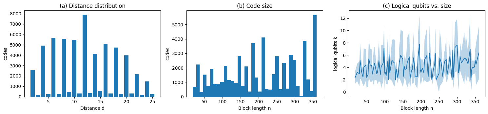
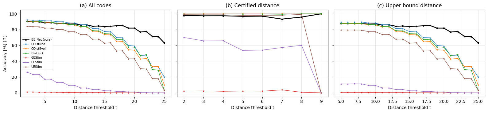
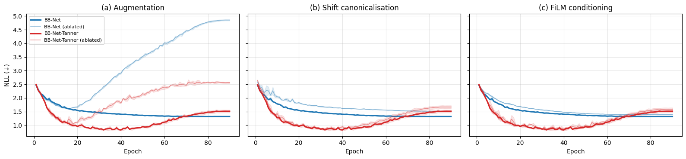

# *Distance Prediction for Quantum Codes* (BB-Net) 재현

다음 논문을 독립적으로 재현한 저장소입니다.

> N. Schneider and E. Nachmani, **Distance Prediction for Quantum Codes**, arXiv:2610.18130 (2026).
> 공식 코드: [NadavSc/BBNet](https://github.com/NadavSc/BBNet)

[](https://colab.research.google.com/github/jykim-UC/bbnet-reproduction/blob/main/notebooks/BBNet_paper_reproduction_v8.ipynb)

English: [README.md](README.md)

## 요약

| | 결과 |
|---|---|
| README 예제 `[[72,12,6]]`, `[[90,8,10]]`, `[[144,12,12]]` 예측 | ✅ **6 / 10 / 12**, 공식 README 와 동일 (학습에서 제외한 코드) |
| 인증된 거리 부분집합 (표 2) | ✅ BB-Net 97.9 % (논문 98.9 %), 휴리스틱도 거의 같음 |
| 거리가 큰 코드에서 BB-Net 이 휴리스틱보다 나음 (그림 4) | ✅ 라벨 19–25: BB-Net 81.9 % 대 QDistRnd 60.0 % |
| Ablation 순위 (표 5) | ✅ BB-Net-Tanner 순위가 논문과 같음, 절대값은 NLL 0.06–0.12 높음 |
| BB-Net 스크리닝 ROC-AUC (표 4) | ✅ 모든 임계값에서 논문과 0.014 이내 |
| 표 7 의 어려운 코드에서 휴리스틱의 과대평가 | ✅ 18개 중 15개, BP-OSD 는 PBB 10개 전부 실패 (논문과 같음) |
| **핵심 주장: 전체에서 BB-Net 이 가장 정확함 (표 1)** | ❌ 정확도(±2) **90.3 %** (논문 **96.4 %**), QDistRnd 가 92.3 % 로 더 높음 |
| 상한 부분집합 (표 3) | ❌ BB-Net 87.7 % (논문 94.7 %) |

차이의 가장 유력한 원인 두 가지는 직접 확인해서 배제했습니다.
- **라벨:** 테스트 코드 955개를 더 큰 예산과 다른 시드로 다시 계산했는데, 바뀐 비율이 0.2 %(무작위 대조군), 0.5 %(BB-Net 불일치 코드)였습니다.
- **논문에 명시되지 않은 학습 세부:** 변형 4가지와 검증 정확도 기준 체크포인트 선택 모두 89.99–90.35 % 였습니다.

남은 차이는 특정 생성 계열에 몰려 있습니다. 그래서 논문이 일부만 설명하고 공개하지 않은 **데이터셋 구성** 차이일 가능성이 가장 큽니다 ([진단](#진단) 참고).

## 공식 코드와 재구성한 부분

공식 저장소(커밋 `f035dcc`, 2026-11-02 기준 변경 없음)에는 `modeling_bbnet.py` 하나만 있습니다. 이 파일은 **수정 없이** 사용합니다. 노트북이 실행 중에 공식 저장소에서 받아 오고, 라이선스가 명시되어 있지 않아 이 저장소에는 포함하지 않았습니다.

| 구성 요소 | 출처 |
|---|---|
| 모델, 입력 특징(다항식 + Tanner 스펙트럼 토큰), shift canonicalisation, 손실 | 공식 `modeling_bbnet.py` (수정 없음) |
| 코드 생성(CSS BB + PBB), 대칭 중복 제거, train/val/test 분할 | 논문 5절, 부록 B 를 보고 재구성 |
| 거리 라벨 | 논문 5절을 보고 재구성 (논문이 쓴 [`codedistance`](https://pypi.org/project/codedistance/) 패키지의 휴리스틱) |
| 학습 루프 | 표 6 하이퍼파라미터, 명시되지 않은 세부는 직접 정함 ([논문과 다른 점](#논문과-다른-점)) |
| 휴리스틱 벤치마크, 정확한 거리 인증, 평가 지표 | 논문 6절을 보고 재구성 |

## 결과

아래 수치는 모두 노트북을 한 번 끝까지 실행(A100 런타임)한 결과입니다. 전체 표는 [results/RESULTS.md](results/RESULTS.md), 모든 출력이 담긴 실행 노트북은 [results/BBNet_paper_reproduction_v7_executed.ipynb](results/BBNet_paper_reproduction_v7_executed.ipynb) 에 있습니다.

### 데이터셋 (5절, 그림 6)

| | 논문 | 재현 |
|---|---|---|
| 코드 수 | 58,704 | 57,236 |
| CSS / PBB | 83.9 % / 16.1 % | 83.5 % / 16.5 % |
| n | 18–360 | 18–360 |
| k | 2–216 | 2–112 |
| 거리 중앙값 | 12 | 12 |



### 테스트 벤치마크 (표 1, 정확도 = |예측 − 라벨| ≤ 2)

| | QDistRnd | QDistEvol | BP-OSD | GEStim | CCStim | UEStim | BB-Net |
|---|---|---|---|---|---|---|---|
| 정확도, 재현 | **92.29** | 90.70 | 90.91 | 0.98 | 26.14 | 84.40 | 90.30 |
| 정확도, 논문 | 92.20 | 94.86 | 82.23 | 0.02 | 34.60 | 61.23 | **96.39** |
| RMSE, 재현 | 2.181 | 2.463 | 2.486 | 15.03 | 13.13 | 7.251 | 1.873 |
| RMSE, 논문 | 2.319 | 1.485 | 23.32 | 4.950 | 9.309 | 1.933 | 1.131 |
| 코드당 초, 재현 | 0.28 | 0.31 | 2.77 | 0.04 | 0.05 | 97.1 | 0.0006 |
| 코드당 초, 논문 | 3.3 | 1.0 | 19.1 | 1.2 | 1.2 | 13.1 | 0.005 |

테스트셋은 5,723개입니다(논문 5,870개). 시간은 하드웨어에 따라 달라서 직접 비교할 수 없습니다.

### 인증 / 상한 부분집합 (표 2–3, 그림 4)

| 정확도(±2) | 인증, 재현 | 인증, 논문 | 상한, 재현 | 상한, 논문 |
|---|---|---|---|---|
| QDistRnd | 100.0 | 100.0 | 89.69 | 86.93 |
| QDistEvol | 100.0 | 100.0 | 87.56 | 91.38 |
| BP-OSD | 99.79 | 99.96 | 87.92 | 70.26 |
| UEStim | 98.96 | 98.44 | 79.48 | 36.10 |
| BB-Net | 97.92 | 98.94 | 87.73 | 94.66 |
| 코드 수 | 1,445 (최대 d 9) | 2,366 (최대 d 14) | 4,278 | 3,504 |

인증된 코드에서 라벨은 100 % 인증 거리와 같았습니다(논문도 100 %). 인증을 코드당 120초 CP-SAT 로 했기 때문에(논문은 코드당 2시간 MILP) 인증 부분집합이 논문보다 작고 쉬운 쪽에 몰려 있습니다.



### Ablation (표 5, 그림 5, 검증 NLL 최저 에폭, 시드 3개)

| 증강 | Shift-canon. | FiLM | BB-Net 재현 | BB-Net 논문 | BB-Net-Tanner 재현 | BB-Net-Tanner 논문 |
|---|---|---|---|---|---|---|
| × | × | ✓ | 1.669 ± 0.019 | 1.496 ± 0.014 | 1.103 ± 0.013 | 1.039 ± 0.019 |
| ✓ | × | ✓ | 1.512 ± 0.015 | 1.436 ± 0.014 | 0.840 ± 0.020 | 0.762 ± 0.012 |
| × | ✓ | ✓ | 1.607 ± 0.022 | 1.409 ± 0.013 | 1.043 ± 0.014 | 0.924 ± 0.026 |
| ✓ | ✓ | × | 1.387 ± 0.003 | 1.217 ± 0.006 | 0.820 ± 0.002 | 0.712 ± 0.025 |
| ✓ | ✓ | ✓ | 1.316 ± 0.004 | 1.157 ± 0.001 | 0.803 ± 0.012 | 0.683 ± 0.010 |



### 스크리닝 AUC (표 4) 와 어려운 코드 (표 7)

BB-Net 의 P(d ≥ t) ROC-AUC 는 t = 4, 8, 10, …, 24 에서 1.000 / 0.998 / 0.995 / 0.993 / 0.988 / 0.987 / 0.984 / 0.978 / 0.979 / 0.977 입니다. 논문은 1.000 … 0.991 입니다.

표 7 의 18개 코드는 학습에서 제외했습니다. 이 코드들에서 우리 기준 거리는 18개 중 15개가 논문과 같았습니다. BB-Net 은 논문 기준 거리와 7개가 정확히 같았고, 13개가 ±2 이내였습니다. 논문 표 7 은 BB-Net 이 맞힌 코드를 골라 실은 것이라, 논문 쪽 18/18 은 선택의 결과입니다.

## 진단

노트북 13절의 결과입니다.

**1. 라벨은 정확합니다.** BB-Net 이 라벨과 ±2 넘게 다른 테스트 코드 555개와 무작위 테스트 코드 400개를 다시 계산했습니다. 원래와 다른 시드에 더 큰 예산(자체 RIS 300,000회, QDistRnd·QDistEvol 각 10,000회)을 썼습니다. 라벨이 낮아진 비율은 대조군 0.2 %, 불일치 코드 0.5 % 였습니다. 즉 BB-Net 의 오답은 라벨 오류가 아니라 실제 모델 오류입니다. 인증된 코드에서 라벨이 100 % 일치한 것과도 맞습니다.

**2. 논문에 명시되지 않은 학습 세부는 원인이 아닙니다.** 주 모델을 네 가지로 다시 학습했습니다.
- 같은 설정 재학습
- 워밍업 뒤 학습률 일정
- fp32 + gradient clipping 없음
- weight decay 를 행렬 파라미터에만 적용

각 실행을 검증 NLL 기준과 검증 정확도 기준 체크포인트로 평가했고, 테스트 정확도는 89.99–90.35 % 였습니다(주 모델 90.30 %).

**3. 오답은 특정 생성 계열과 중간 거리 구간에 몰려 있습니다.**

| 부분집합 | 코드 수 | BB-Net | QDistRnd (200회) |
|---|---|---|---|
| CSS | 4,818 | 89.2 | 90.9 |
| PBB | 905 | 95.9 | 99.6 |
| 4항식 계열 (논문의 정의되지 않은 "adversarial" 계열 대용) | 864 | **70.6** | 82.1 |
| 나머지 계열 | 4,859 | ≈ 93.8 | ≈ 94.1 |
| 라벨 d 2–6 / 7–10 / 11–14 | 1,299 / 1,203 / 1,289 | 98.5 / 93.1 / 89.0 | 100 / 100 / 99.4 |
| 라벨 d 15–18 / 19–25 | 1,070 / 862 | 85.5 / 81.9 | 91.8 / 60.0 |

BB-Net 의 오답은 라벨보다 작게 예측한 경우 55 %, 크게 예측한 경우 45 % 로 거의 대칭입니다.

논문은 생성기를 "separable, coordinate-swapped, mixed-monomial, trinomial, and adversarial BB specifications together with valid PBB expansions" 라고만 설명합니다. 계열 비율, "adversarial" 의 정의, PBB 구성 방법은 밝히지 않았고 데이터셋도 공개하지 않았습니다. 그래서 남은 차이는 데이터셋 구성의 차이로 보는 것이 가장 타당하며, 저자의 데이터 없이는 확정할 수 없습니다.

## 논문과 다른 점

1. **데이터셋.** 논문의 규칙대로 새로 생성했습니다.
   - CSS 5개 계열을 같은 비율로 만들었고, "adversarial" 은 4항 다항식으로 대신했습니다.
   - PBB 는 교환 조건을 만족하는 1–2항 C, D 를 전수 탐색해 붙였습니다.
   - 대칭 중복은 Aut(ℤℓ×ℤm), 평행이동, 레지스터 교환으로 제거했습니다.
2. **라벨.** 자체 numba RIS(30,000회, CSS 전용), QDistRnd(2,000회), QDistEvol(2,000회) 의 최솟값입니다. 논문은 BP-OSD, QDistRnd, QDistEvol 각 10,000회입니다. 라벨 품질은 위에서 검증했습니다.
3. **인증.** 코드당 120초 CP-SAT 입니다. 라벨 거리 > 14 인 코드는 시도하지 않았습니다(논문에서도 인증된 사례가 없음).
4. **CSS 코드의 휴리스틱.** Z 성분만 계산합니다(BB 코드는 d_X = d_Z). UEStim 은 `codedistance` 에서 결정적이라 한 번만 실행했습니다(논문은 "3 trials").
5. **학습.** 9 에폭 워밍업 뒤 코사인 감쇠, gradient clipping 1.0, bf16 autocast, 검증 NLL 최저 체크포인트를 썼습니다. 모두 논문에 명시되지 않은 부분이고, 진단 2 에서 영향이 없음을 확인했습니다.
6. **평가 지표.** 휴리스틱 실패 출력의 처리는 논문에 명시되어 있지 않습니다.
   - witness 가 식 (4) 를 만족하지 않으면 오답으로 셉니다.
   - RMSE 는 반환값을 그대로 씁니다.
   - AUC 는 실패를 최저 점수로 매기고, 다른 처리 방식의 결과도 노트북에 함께 출력합니다.
7. **학습에서 제외한 코드.** README 예제와 표 7 코드는 대칭 궤도까지 포함해 학습에서 제외했습니다.

## 실행 방법

Colab 에서 노트북을 열고(A100 또는 G4, 고용량 RAM) **런타임 → 모두 실행** 을 누릅니다.

- **저장과 재개.** 모든 단계가 `내 드라이브/bbnet_repro/` 에 저장되어, 끊겨도 다시 실행하면 이어서 진행합니다.
- **계정 이전.** 다른 Google 계정으로 옮길 때는 노트북의 부록 A 를 참고하세요.
- **커밋 고정.** 공식 코드는 커밋 `f035dcc` 로 고정해서 받아 옵니다.

12 vCPU A100 Colab 런타임 기준 대략적인 비용은 다음과 같습니다.
- **학습:** 30회(주 모델 + ablation), 회당 약 30분. 진단용 변형 4회가 더 있습니다.
- **휴리스틱 벤치마크:** 하루 정도. 코드당 약 97초인 UEStim 이 대부분을 차지합니다.
- **라벨과 인증:** 각각 몇 시간.

CPU 단계는 별도 프로세스에서 돕니다. OR-Tools 와 PyTorch 를 한 프로세스에 올리면 segfault 가 나기 때문입니다.

## 저장소 구성

```
notebooks/BBNet_paper_reproduction_v8.ipynb   처음부터 끝까지 실행하는 노트북 (src/ 모듈을 직접 작성)
src/                                           같은 모듈의 단독 파일
  bbdist.py    GF(2) 선형대수와 RIS 거리 탐색 (numba)
  bbrepro.py   코드 구성, Aut(G) 대칭, 생성, 라벨, codedistance 래퍼, CP-SAT/MILP 인증
  bbstages.py  재개 가능한 CPU 단계 (generate, labels, bench, cert, table7, relabel)
  bbtrain.py   학습, 평가, ablation 과 진단용 변형
results/       그림, 전체 표, 실행된 노트북
data/          생성한 데이터셋과 벤치마크 결과 (data/README.md 참고)
scripts/       Drive 결과를 data/ 로 내보내는 도구
```

## 인용

```bibtex
@misc{schneider2026distancepredictionquantumcodes,
  title={Distance Prediction for Quantum Codes},
  author={Nadav Schneider and Eliya Nachmani},
  year={2026}, eprint={2610.18130}, archivePrefix={arXiv}, primaryClass={quant-ph}
}
```

이 저장소는 논문 저자와 관련이 없습니다. 이 저장소의 코드는 MIT 라이선스입니다(`LICENSE`). `modeling_bbnet.py` 의 권리는 원저자에게 있으며, 실행 중에 공식 저장소에서 받아 옵니다.
