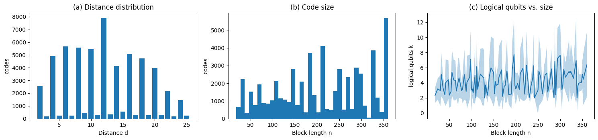
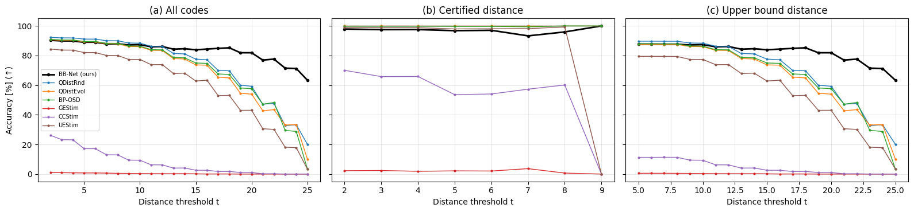
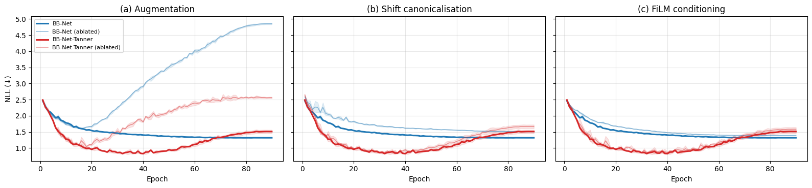

# Reproducing *Distance Prediction for Quantum Codes* (BB-Net)

An independent reproduction of

> N. Schneider and E. Nachmani, **Distance Prediction for Quantum Codes**, arXiv:2610.18130 (2026).
> Official code: [NadavSc/BBNet](https://github.com/NadavSc/BBNet)

[](https://colab.research.google.com/github/jykim-UC/bbnet-reproduction/blob/main/notebooks/BBNet_paper_reproduction_v8.ipynb)

한국어: [README.ko.md](README.ko.md)

## TL;DR

| | Result |
|---|---|
| README quick-start predictions `[[72,12,6]]`, `[[90,8,10]]`, `[[144,12,12]]` | ✅ **6 / 10 / 12**, identical to the official README (codes excluded from training) |
| Certified-distance subset (Table 2) | ✅ BB-Net 97.9 % vs 98.9 % in the paper; heuristics match closely |
| BB-Net better than heuristics on high-distance codes (Fig. 4) | ✅ labels 19–25: BB-Net 81.9 % vs QDistRnd 60.0 % |
| Ablation ranking (Table 5) | ✅ same ordering for BB-Net-Tanner; absolute NLL 0.06–0.12 higher |
| Screening ROC-AUC of BB-Net (Table 4) | ✅ within 0.014 of the paper at every threshold |
| Heuristics overestimate the hard codes of Table 7 | ✅ 15 / 18 codes; BP-OSD fails on all 10 PBB codes, as in the paper |
| **Headline: BB-Net is the most accurate method overall (Table 1)** | ❌ **90.3 %** accuracy (±2) vs **96.4 %** in the paper; QDistRnd reaches 92.3 % |
| Upper-bound subset (Table 3) | ❌ BB-Net 87.7 % vs 94.7 % in the paper |

We checked the two most likely causes of the gap and ruled them out. **Labels:** recomputing 955 test labels with a larger budget and a new seed changed 0.2 % (random controls) and 0.5 % (BB-Net disagreements). **Training details** the paper does not specify: four variants and checkpoint selection by validation accuracy all land within 89.99–90.35 %. The remaining gap is concentrated in one family of generated codes, so it most likely comes from the **dataset composition**, which the paper describes only partially and which is not public (see [Diagnostics](#diagnostics)).

## What is official and what is reconstructed

The official repository (commit `f035dcc`, unchanged as of 2026-11-02) contains only `modeling_bbnet.py`. We use it **unmodified**. The notebook clones it at runtime; it is not redistributed here because the repository has no license.

| Component | Source |
|---|---|
| Model, featurisation (polynomial + Tanner-spectral tokens), shift canonicalisation, loss | official `modeling_bbnet.py`, unmodified |
| Code generation (CSS BB + PBB), symmetry deduplication, train/val/test split | reconstructed from Sec. 5 and App. B |
| Distance labels | reconstructed from Sec. 5 (heuristics from the [`codedistance`](https://pypi.org/project/codedistance/) package the paper uses) |
| Training loop | Table 6 hyper-parameters; unspecified details chosen by us (see [Deviations](#deviations-from-the-paper)) |
| Heuristic benchmark, exact certification, metrics | reconstructed from Sec. 6 |

## Results

All numbers below come from one full run of the notebook (A100 runtime) and are compared with the paper. Full tables: [results/RESULTS.md](results/RESULTS.md). The executed notebook with every output: [results/BBNet_paper_reproduction_v7_executed.ipynb](results/BBNet_paper_reproduction_v7_executed.ipynb).

### Dataset (Sec. 5, Fig. 6)

| | Paper | Ours |
|---|---|---|
| Codes | 58,704 | 57,236 |
| CSS / PBB | 83.9 % / 16.1 % | 83.5 % / 16.5 % |
| n | 18–360 | 18–360 |
| k | 2–216 | 2–112 |
| Median distance | 12 | 12 |



### Test benchmark (Table 1; accuracy = |prediction − label| ≤ 2)

| | QDistRnd | QDistEvol | BP-OSD | GEStim | CCStim | UEStim | BB-Net |
|---|---|---|---|---|---|---|---|
| Accuracy, ours | **92.29** | 90.70 | 90.91 | 0.98 | 26.14 | 84.40 | 90.30 |
| Accuracy, paper | 92.20 | 94.86 | 82.23 | 0.02 | 34.60 | 61.23 | **96.39** |
| RMSE, ours | 2.181 | 2.463 | 2.486 | 15.03 | 13.13 | 7.251 | 1.873 |
| RMSE, paper | 2.319 | 1.485 | 23.32 | 4.950 | 9.309 | 1.933 | 1.131 |
| s / code, ours | 0.28 | 0.31 | 2.77 | 0.04 | 0.05 | 97.1 | 0.0006 |
| s / code, paper | 3.3 | 1.0 | 19.1 | 1.2 | 1.2 | 13.1 | 0.005 |

Our test set has 5,723 codes (paper: 5,870). Timings depend on hardware and are not comparable.

### Certified vs upper-bound subsets (Tables 2–3, Fig. 4)

| Accuracy (±2) | Certified, ours | Certified, paper | Upper bound, ours | Upper bound, paper |
|---|---|---|---|---|
| QDistRnd | 100.0 | 100.0 | 89.69 | 86.93 |
| QDistEvol | 100.0 | 100.0 | 87.56 | 91.38 |
| BP-OSD | 99.79 | 99.96 | 87.92 | 70.26 |
| UEStim | 98.96 | 98.44 | 79.48 | 36.10 |
| BB-Net | 97.92 | 98.94 | 87.73 | 94.66 |
| Codes | 1,445 (max d 9) | 2,366 (max d 14) | 4,278 | 3,504 |

Labels equal the certified distance on 100 % of certified codes (paper: 100 %). Our certified subset is smaller and easier than the paper's because we certify with CP-SAT at 120 s per code (paper: MILP, 2 h per code).



### Ablation (Table 5, Fig. 5; best-epoch validation NLL, 3 seeds)

| Aug. | Shift-canon. | FiLM | BB-Net, ours | BB-Net, paper | BB-Net-Tanner, ours | BB-Net-Tanner, paper |
|---|---|---|---|---|---|---|
| × | × | ✓ | 1.669 ± 0.019 | 1.496 ± 0.014 | 1.103 ± 0.013 | 1.039 ± 0.019 |
| ✓ | × | ✓ | 1.512 ± 0.015 | 1.436 ± 0.014 | 0.840 ± 0.020 | 0.762 ± 0.012 |
| × | ✓ | ✓ | 1.607 ± 0.022 | 1.409 ± 0.013 | 1.043 ± 0.014 | 0.924 ± 0.026 |
| ✓ | ✓ | × | 1.387 ± 0.003 | 1.217 ± 0.006 | 0.820 ± 0.002 | 0.712 ± 0.025 |
| ✓ | ✓ | ✓ | 1.316 ± 0.004 | 1.157 ± 0.001 | 0.803 ± 0.012 | 0.683 ± 0.010 |



### Screening AUC (Table 4) and hard codes (Table 7)

The BB-Net ROC-AUC for P(d ≥ t) is 1.000 / 0.998 / 0.995 / 0.993 / 0.988 / 0.987 / 0.984 / 0.978 / 0.979 / 0.977 for t = 4, 8, 10, …, 24. The paper reports 1.000 … 0.991. For the 18 codes of Table 7 (excluded from our training data), our reference distances equal the paper's on 15 / 18. Our BB-Net matches the paper's reference exactly on 7 / 18 and within ±2 on 13 / 18. The paper's table lists codes on which BB-Net was correct, so 18 / 18 there is by selection.

## Diagnostics

These come from §13 of the notebook.

**1. Labels are accurate.** We recomputed 555 test codes where BB-Net disagrees with the label by more than 2, plus 400 random test codes. The recomputation used a new seed and a larger budget: our RIS search with 300,000 trials, plus QDistRnd and QDistEvol with 10,000 trials each. Labels decreased for 0.2 % of the random codes and 0.5 % of the disagreements. BB-Net's errors are therefore real model errors, not label noise. This is consistent with the 100 % agreement on certified codes.

**2. Unspecified training details do not matter.** We retrained the main model four ways: an identical replicate, a constant learning rate after warm-up, fp32 without gradient clipping, and weight decay on weight matrices only. Each run was evaluated at its best-NLL and best-accuracy checkpoints. Test accuracy: 89.99–90.35 % (main model: 90.30 %).

**3. Errors concentrate in one generator family and in mid-range distances.**

| Subset | Codes | BB-Net | QDistRnd (200) |
|---|---|---|---|
| CSS | 4,818 | 89.2 | 90.9 |
| PBB | 905 | 95.9 | 99.6 |
| weight-4 family (our stand-in for the paper's undefined "adversarial" family) | 864 | **70.6** | 82.1 |
| all other families | 4,859 | ≈ 93.8 | ≈ 94.1 |
| label d 2–6 / 7–10 / 11–14 | 1,299 / 1,203 / 1,289 | 98.5 / 93.1 / 89.0 | 100 / 100 / 99.4 |
| label d 15–18 / 19–25 | 1,070 / 862 | 85.5 / 81.9 | 91.8 / 60.0 |

BB-Net's errors are roughly symmetric: 55 % under-predict and 45 % over-predict the label. The paper describes its generator only as "separable, coordinate-swapped, mixed-monomial, trinomial, and adversarial BB specifications together with valid PBB expansions". It does not specify the family proportions, the "adversarial" construction, or the PBB construction, and the dataset is not released. Our best explanation for the remaining gap is therefore a different dataset composition. This cannot be settled without the authors' data.

## Deviations from the paper

1. **Dataset.** Generated anew with the paper's rules. Equal quotas for five CSS families, with weight-4 polynomials standing in for "adversarial". PBB codes add 1–2-term C, D, found by exhaustive search for commuting pairs. Symmetry duplicates are removed under Aut(ℤℓ×ℤm), translations, and register swaps.
2. **Labels.** Minimum over our numba RIS search (30,000 trials, CSS only), QDistRnd (2,000) and QDistEvol (2,000). The paper uses 10,000 trials each of BP-OSD, QDistRnd and QDistEvol. We verified the labels above.
3. **Certification.** CP-SAT with a 120 s limit per code. Codes with label d > 14 are not attempted, because none were certified in the paper either.
4. **Heuristics on CSS codes.** Run on the Z component only (d_X = d_Z for BB codes). UEStim is run once, since it is deterministic in `codedistance` (the paper says "3 trials").
5. **Training.** Cosine decay after the 9-epoch warm-up, gradient clipping 1.0, bf16 autocast, checkpoint with the lowest validation NLL. None of these are specified in the paper; see Diagnostics 2.
6. **Metrics.** The paper does not specify how it handles failed heuristic outputs. Invalid witnesses (Eq. 4) count as wrong. RMSE uses the returned value. AUC ranks failures lowest; the notebook also reports alternatives.
7. **Held-out codes.** The README examples and the Table 7 codes (with their symmetry orbits) are excluded from training.

## How to run

Open the notebook in Colab (A100 or G4 runtime, high RAM) and choose **Runtime → Run all**.

- **Saving and resuming.** Every stage writes to `MyDrive/bbnet_repro/` and resumes after a disconnect.
- **Moving to another account.** Use Appendix A of the notebook to move results to another Google account.
- **Pinned commit.** The notebook pins the official code to commit `f035dcc`.

Approximate cost on a 12-vCPU A100 Colab runtime:
- **Training:** 30 runs (main model and ablations) of about 30 min each, plus 4 diagnostic variants.
- **Heuristic benchmark:** about one day of wall-clock time, dominated by UEStim at ~97 s per code.
- **Labeling and certification:** several hours each.

The CPU stages run in separate processes, because OR-Tools and PyTorch crash when loaded in the same process.

## Repository layout

```
notebooks/BBNet_paper_reproduction_v8.ipynb   end-to-end notebook (writes the src/ modules itself)
src/                                           the same modules as standalone files
  bbdist.py    GF(2) linear algebra and RIS distance search (numba)
  bbrepro.py   code construction, Aut(G) symmetries, generation, labels, codedistance wrappers, CP-SAT/MILP certification
  bbstages.py  resumable CPU stages (generate, labels, bench, cert, table7, relabel)
  bbtrain.py   training, evaluation, ablation and diagnostic variants
results/       figures, full tables, executed notebook
data/          generated dataset and benchmark outputs (see data/README.md)
scripts/       helper to export the Drive artifacts into data/
```

## Citation

```bibtex
@misc{schneider2026distancepredictionquantumcodes,
  title={Distance Prediction for Quantum Codes},
  author={Nadav Schneider and Eliya Nachmani},
  year={2026}, eprint={2610.18130}, archivePrefix={arXiv}, primaryClass={quant-ph}
}
```

This repository is not affiliated with the authors. Our code is released under the MIT license (see `LICENSE`). `modeling_bbnet.py` belongs to its authors and is downloaded from the official repository at runtime.
